<p align="center"></p>

<h1 align="center">Isekai</h1>

<p align="center"><b>An agent harness where the law is the harness.</b><br>
One Go binary. The convention isn't a prompt the model may skip — the gate, the log, the human
gate, the sandbox and the memory are code paths it cannot route around.</p>

---

## Why

Coding agents read their project's rules and then, sometimes, don't follow them. Isekai turns a
directory into a **world** governed by [`ISEKAI.md`](ISEKAI.md) and runs the agent inside that
law:

- **The gate** — every turn that changed the world is checked before it's reported done: the right
  creature authored it, its invariants hold, its duties are done, its doc changed with it. The
  verdict lands in an append-only `log.md`.
- **The human gate** — every action is classified (`read` · `write` · `outward` · `destructive`)
  before it runs. Outward and destructive acts ask you; per-command rules (`bash:git push*`) can
  allow, ask or deny. The model's claim about a command can only make it stricter.
- **The sandbox** — `bash` runs in a persistent shell under `bwrap` (Linux) or Seatbelt (macOS):
  the filesystem read-only except the world, no network unless the gate let the act out, secrets
  scrubbed from the env.
- **Memory, native** — recall before every step, remember after; knowledge the agent held but never
  wrote down (*the unsaid*) is surfaced and routed to where it belongs. When context fills, it is
  **drained** into those homes by pointer, not summarized away.
- **Ranks and offices** — the session (Rimuru) dispatches Court Bodies to Elves, Orcs and Slimes;
  each office (Great Sage reads, Raphael judges, Ciel writes) can run on its own model.
- **Everything on, config takes away** — every tool, law feature and instrument is switchable in
  YAML or JSON, and a switched-off law is always shown, never silent.

## Install

```sh
curl -fsSL -o install.sh https://raw.githubusercontent.com/Kaginari/isekai/main/install.sh
sh install.sh                     # downloads the release for your OS and checks it against checksums.txt
# or
go install github.com/Kaginari/isekai/cmd/isekai@latest
```

Or build it: `CGO_ENABLED=0 go build -o isekai ./cmd/isekai` (Go ≥ 1.26).

Release archives for linux/macOS × amd64/arm64 ship with `checksums.txt` and build provenance:
`gh attestation verify <archive> --repo Kaginari/isekai`. A container image to try the binary:
`docker run --rm -it -e ANTHROPIC_API_KEY -v "$PWD:/work" ghcr.io/kaginari/isekai:latest` — the
binary alone on Debian slim (no bubblewrap, git or toolchains); for real work in a container use
`--docker-agent`, which builds a runtime with them.

**Requirements.** Linux or macOS. `bubblewrap` (`bwrap`) for the sandboxed shell on Linux — without it
the shell runs unsandboxed and `status` says so; macOS uses its built-in `sandbox-exec`. Docker for
`--docker-agent`.
Chromium or Chrome for `ui check`'s screenshots.

**Data boundary.** No telemetry. The binary contacts only the providers you configure (and the
package or container registries you name); any other network act is `outward` and asks you, and the
sandboxed shell has no network unless an `outward` act was approved.

## Quick start

```sh
cd your-project
export ANTHROPIC_API_KEY=…        # or any OpenAI-compatible endpoint (vLLM, Ollama, OpenRouter)
isekai init --level complex      # found a world here — light: the law only · medium: a colony read from the tree, no model · complex: the model reads all the code and hires the team
isekai                           # the live session — the dashboard opens at http://127.0.0.1:7411/
isekai run "add a health check endpoint and its test"
```

## Inside Claude Code

You can keep Claude Code as the agent and let isekai hold the law. Claude Code runs the model, the
tools and the session on your own plan; the binary runs from Claude Code's hooks, where the model
cannot skip it. It never calls a model itself, so it needs no API key.

```sh
cd your-project && isekai init   # found the world, if it is not one yet
isekai install --claude          # shows the hooks; --yes writes .claude/settings.local.json
isekai install --claude --global --yes   # or for every world on this machine (silent elsewhere)
```

| Claude Code event | What the law does |
|---|---|
| `SessionStart` (also after `/clear` and compaction) | the crest, the log's last entries and how the law runs here, as context |
| `UserPromptSubmit` | the turn's baseline, and recall for the ask: memory anchors and the tools that fit |
| `PreToolUse` | the guard refuses the catastrophic; outward and destructive acts ask — it only ever tightens Claude Code's own permissions |
| `PostToolUse` | the paths a file tool wrote, for the gate |
| `Stop` | the gate over everything the turn changed (shell writes too): a territory changed without its doc, or a failing verify line, sends the turn back with the reasons; the verdict lands in `log.md` |

### The world's memory over MCP

`isekai mcp serve` serves the world's memory to any MCP client on stdio — Claude Code, OpenCode,
or another harness. Three tools, the instrument the binary's own loop uses: **`recall`** (what the
world remembers about a question — log entries, docs, the law, notes from earlier sessions, ranked
by meaning, then by relation), **`remember`** (file a note every later session recalls; `machine:
true` files it for every world on this machine) and **`memory_status`**. The world is the one found
from the working directory up, or `--root <dir>`; a note filed by one client is recalled at once by
any other, and by isekai's own sessions.

```sh
claude mcp add isekai-memory -- isekai mcp serve        # Claude Code
```

```jsonc
// .mcp.json (Claude Code) — or opencode.json: "mcp": { "isekai-memory": { "type": "local", "command": ["isekai", "mcp", "serve"] } }
{ "mcpServers": { "isekai-memory": { "command": "isekai", "args": ["mcp", "serve"] } } }
```

## The CLI, seen

A working session: the ask up top, every classified step drawn as it lands:

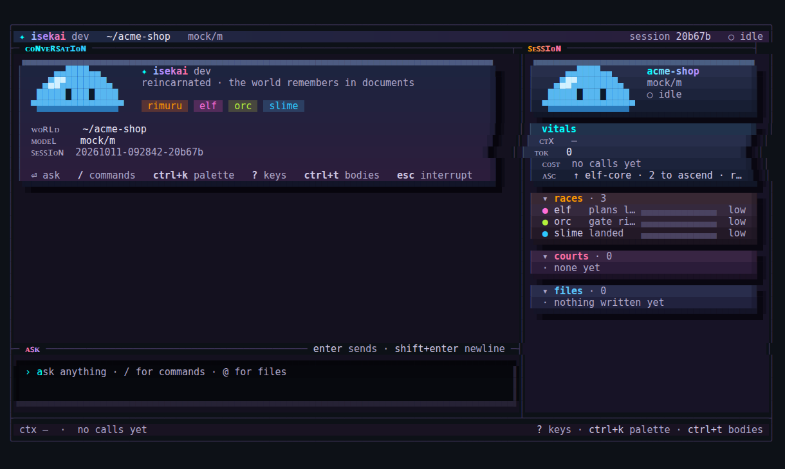

## Architecture

**Wrapped layers.** A model on its own is text in, text out — no hands, no memory, no check on
itself. A *body* is that model inside a loop with tools. A *world* is everything around the loop.
Isekai is one static Go binary at the outermost shell — the law runs code:

<table>
<tr><th>layer</th><th>wraps</th><th>is</th></tr>
<tr><td><b>LLM</b></td><td>—</td><td>the bounded mind — text in, text out; no hands, no memory, no check on itself</td></tr>
<tr><td><b>body</b></td><td>the LLM</td><td>the model inside a loop with tools — the model walks</td></tr>
<tr><td><b>world</b></td><td>the body</td><td>loop + context/memory + permissions/sandbox — the code protects</td></tr>
<tr><td><b>Isekai</b></td><td>the world</td><td>one static Go binary at the outermost shell — the law runs code</td></tr>
</table>

**Six beats per step, one model call.** The model lives only in the plan-and-act beats; perceive,
recall, verify and record are code — no tokens, milliseconds. `law.guts` scores each act at verify
and speaks once inside a slide; the witness demand runs at close when files were written.

<table>
<tr><th>beat</th><th>runs on</th><th>spend</th></tr>
<tr><td>1 · perceive — context read, budgets before any call</td><td>code</td><td>no tokens</td></tr>
<tr><td>2 · recall — anchors rebuilt per call, never cached</td><td>code</td><td>no tokens</td></tr>
<tr><td>3 · plan — <b>the one model call</b></td><td>model</td><td>tokens</td></tr>
<tr><td>4 · act — the tool calls the plan ordered</td><td>model directs, code runs</td><td>tokens (the plan's)</td></tr>
<tr><td>5 · verify — checks run; <code>law.guts</code> scores the act</td><td>code</td><td>no tokens</td></tr>
<tr><td>6 · record — journal, memory, roster state</td><td>code</td><td>no tokens</td></tr>
</table>

**A task, end to end** — tools act inside the world; nothing closes on belief.

<ol>
<li>the task lands — a prompt, or a commission a court carries</li>
<li>perceive: context read, budgets checked before any call</li>
<li>recall: anchors + the world's law rebuilt for this call</li>
<li>one model call — the plan
<ol type="a">
<li>each tool call it orders is classified first (read · write · outward · destructive)</li>
<li>the guard refuses catastrophic patterns before any ask</li>
<li>outward and destructive ride to the human gate; a denial comes back as a message the model reads</li>
<li>an approved act runs sandboxed — timeout, kill tree, fs under the root</li>
<li>the step lands: observe marks it, record journals it — and while tool calls remain, the loop turns again</li>
</ol></li>
<li>the model stops calling tools: the turn-end gate runs its checks — wrote files? an orc holds the gate</li>
<li>the wire rides up: status, findings, holes, unsaid — the context dies with the task</li>
</ol>

## What lands where

Three tiers keep the law clean: rules teach, code enforces, instruments remember.

<table>
<tr><th>tier</th><th>duty</th><th>homes</th></tr>
<tr><td><b>rules teach</b></td><td>steer the model</td><td><code>ISEKAI.md</code> · <code>rules:</code> entries — injected into the system prompt, advice never law</td></tr>
<tr><td><b>code enforces</b></td><td>protect the world</td><td>the gate · permissions · the guard · budgets · territory ownership</td></tr>
<tr><td><b>instruments remember</b></td><td>make runs accountable</td><td>the wire formats (<code>@S</code>/<code>@F</code>/<code>@?</code>/<code>@U</code>) · the journal · memory anchors</td></tr>
</table>

**Terminology, once and for all.** A *prompt* is what you type — the ask. A *system prompt* is the
machine's standing instruction, auto-composed at every turn before the ask rides in. *Code* is
everything the world enforces without asking a body to believe anything.

**The system prompt, composed per turn, contains:**

- identity + standing: who this body is, the world it belongs to, its ranks and offices
- the law: `ISEKAI.md` in full when `law.principles` is on (default), plus every `rules:` entry
  verbatim
- the four action classes and who asks before a privileged one runs
- the wire it must answer in (`@S` / `@F` / `@U` / `@D` / `@E`)
- instrument readings it may claim: budgets read per step; the guts' announced behavior
- docs-as-code duty and the colony map for this world

**In per-step context, on top of the ask:**

- memory anchors: notes matched to this ask (short / long / shared tiers, budgeted)
- the toolbox manifest — only the tools that fit this step's question
- working notes, journal tails, the last tool results (the step's own evidence)
- the witness demands when files were written and the body's close is being checked

**Never in any prompt — coded and enforced:**

- the guard (dangerous commands refused before any approval) and the gate (who may approve)
- the sandbox knot (bwrap / the `--docker-agent` container)
- budgets read as instruments: context window % readings, stress-zone behavior, session wallets
- the closing witness's admissibility rule (machine-check or independent method)
- the guts' scoring, the echo penalty, and where every reading journals
- wire parsing, reports, sessions, undo, hooks — surface, not advice

- **`rules:` are converted to the system prompt.** Each `text:` line is law text the binary reads
  into every turn's system message — shape culture here, never private muscle (omitted from a
  subagent's prompt unless `raw` is on; an entry can be a file path instead of inline text).
- **The ask, memory anchors, the toolbox manifest and witness evidence go in per-step context** —
  what this step needs, nothing it doesn't.
- **`law:` is enforced in code, never prompted** — the guard and gate classes, the sandbox,
  budgets read as instruments, the closing witness demand, the guts' scoring. A body can only
  tighten a law, never loosen it; `status` names every switched-off law aloud.

## Value and meters

Each race is measured by its own job, from one ledger (`.isekai/shared/value.jsonl`, one row
per run per body, always kept) under one definition of success (`law.value`: `DONE`/`PASS`
pass, `FAIL`/`ESCALATE`/`CHECKPOINT` fail, the human's `DENIED`, `INTERRUPTED`, `DRY` and
`SUSPENDED` neutral). A rank's flags give it a family and the family a score: a slime is scored
on what landed and passed its gate first try, an orc on verdicts nobody overturned and the health
of the slimes it ran, an elf on the plans that landed, the throne on the asks it closed for good.
Only the holes the harness caught against the body cost it — a provider refusal or an honest `@?`
never does.

```yaml
ranks:
  slime:
    value:
      score: "0.5*landRate + 0.5*gateRate"
      meter: {signal: gateRate, label: First try, bands: {ok: 85, warn: 60}}
```

The dashboard's Metrics tab ranks the creatures by score (a body under its race's record is shown,
never ranked), each race shows its own meter, every neuron wears a band ring, and `ascendsWhen`
can read `score` and every signal. The terminal's sidebar wears them too: each race's meter (its
label, its reading, a bar in its band; a short record dimmed and unranked), each Court's reading
beside its state, the throne's own score and the body nearest its ascension (`orc-engine · reports
17/20 to ascend`); its context and plan gauges band by the same meters (`ui.meters`). `isekai config explain value` prints each race's resolved law
and where each part came from; the full law is [`docs/canon/races.md`](docs/canon/races.md) §Value.

**Evolution.** A creature that reads stressed (council strain, a streak of failed gates, a doom
checkpoint) while its `## Thoughts` desk holds more than seven entries heals itself in the same
wave (`law.evolution`, on by default). The harness picks one arm from evidence and logs why:
**split** a large zone whose failures cluster in two sub-directories into two young, each with its
half and its Thoughts; **rebirth** a genome its own verify or the tree contradicts, from the code as
it is now (the old doc goes to the attic, the value record starts again); or **mutate**, distilling
the repeated lesson into traits and minting a recurring how as a crafted skill it wears. Each arm
is staged and proven (verify green, the ontology no worse) before it lands, then on cooldown for
ten of the body's runs. `mode: propose` queues it instead: `isekai evolve list|show|apply|reject`.
The terminal toasts it, the dashboard rings the neuron in the arm's colour, `isekai status` and
`/api/value` show each body's desk and cooldown; `isekai config explain evolution` prints the law.

## The forge

A run that walked a path worth repeating can leave it behind as a skill or a tool.

1. **Draft.** A Court names it on its report: `@FORGE skill:<name> | <when> | <how>` or
   `@FORGE tool:<name> | <summary> | <argv>` (holes as `{{param}}`). A run of
   `law.forge.demandAtSteps` steps or more (12; 0 = off) is asked for one at its close.
2. **Filed.** The harness files each draft from the report it holds, so a long report or one cut
   by `@CAP` keeps its draft. Each draft becomes one shared note with the drafting body, its run
   and a content hash. A line relayed up the ranks is filed once, as its drafter's. The `remember`
   tool refuses the forge's tags: only the harness files drafts.
3. **The desk.** `/forge` in a session, or `isekai forge list` headless, lists the open drafts by
   a stable id (the hash): name, version, body, run, age, kind, and a tool's class.
   `show <id>` prints what a mint would write. `reject <id> <why>` closes a draft with an
   append-only mark.
4. **Mint.** A skill becomes `.isekai/crafted-skills/<name>/SKILL.md` in Claude Code's format
   (`name` in `[a-z0-9-]`, `description` is the *when*, the body is the *how*). It also carries
   `version`, `status`, `by`, `born` (the run) and `minted`. A crafted skill outranks every other
   home of the same name, and a name already worn elsewhere is refused. A mint never overwrites:
   a newer draft of a crafted name shows as `v2` and lands only with `--version`, the old file
   kept under `versions/`. A body whose doc names the skill wears it (`@T mind <name>` in its
   prompt), and any body loads it with `skill{name}`.
   A tool becomes a `tools.custom` entry. Its argv is split with shell quoting (a pipeline is
   refused), its class comes from the classifier, and an interpreter running a string
   (`bash -c`, `python -c`, `node -e`, `eval`) is refused unless `--force`. An outward or
   destructive tool needs your yes (`--yes` headless). The YAML is printed before it is written,
   with its provenance under `crafted:`.

## The terminal

A terminal UI in the class of Claude Code, built on the Charm libraries: the conversation flows into
your scrollback, and every event of the loop is drawn — thinking, tool calls, diffs, Courts, the gate.


The model's thinking streams while it arrives and folds when the answer starts; each rank has its own
face and verbs beside the spinner:

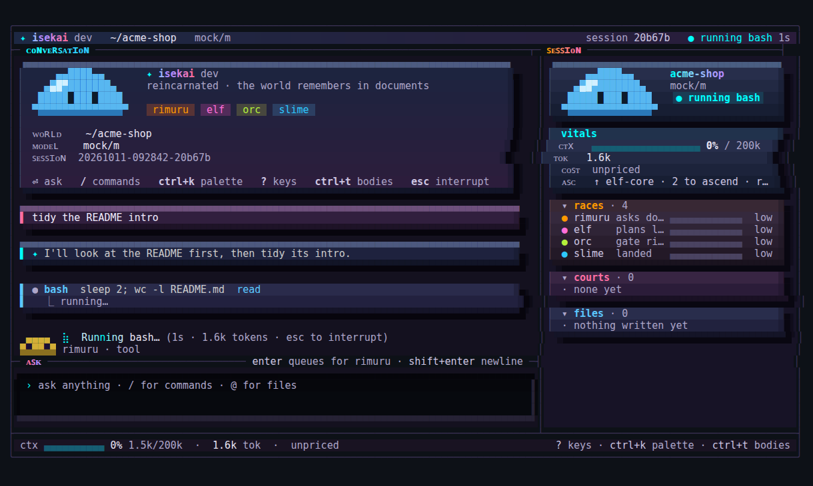

When a turn wrote files, the orc weighs the verdict before the turn is done:

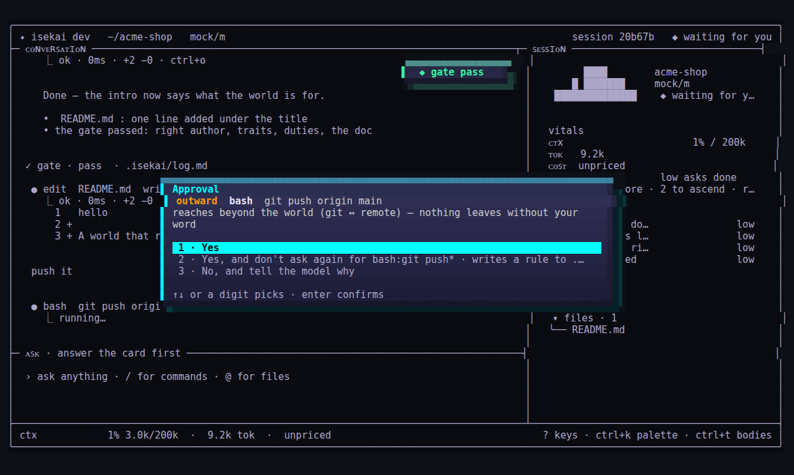

Tool calls are cards edged in their class's colour; diffs keep the code's own colours:

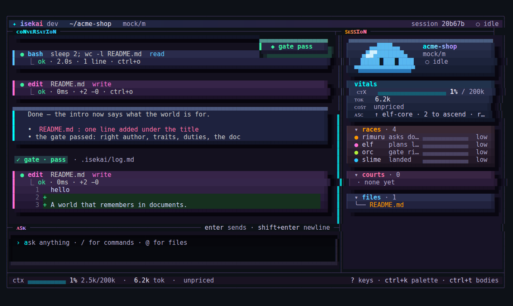

`ctrl+t` watches every body — the session and each Court, its thinking and its steps, live:

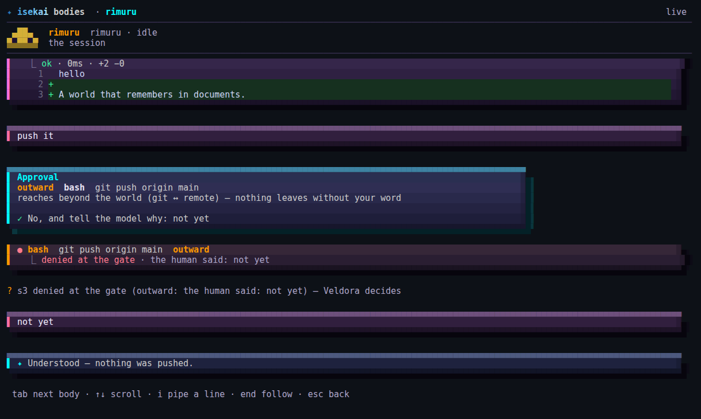

`/board` shows the world full screen — the agents, the reasoned ontology as a graph, the offices, the
usage — and `ctrl+k` opens a fuzzy command palette:

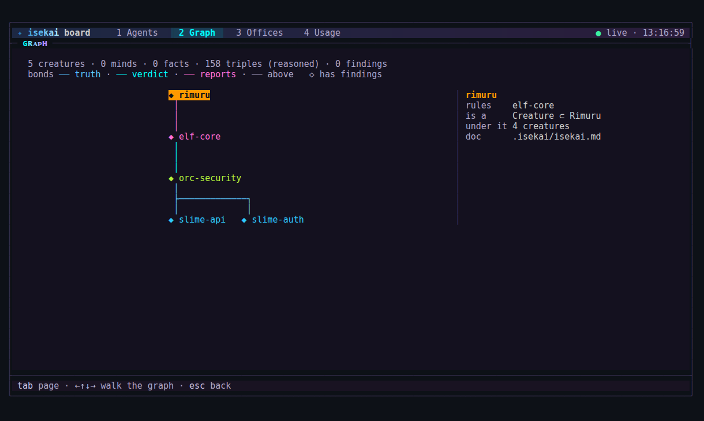

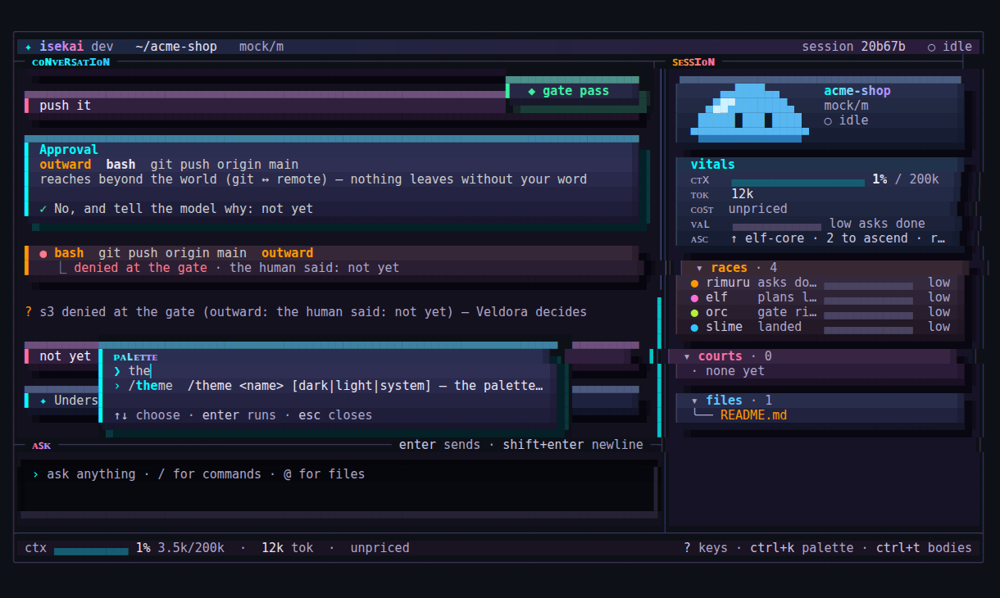

| Key | |
|---|---|
| `enter` · `shift+enter` | send · newline |
| `/` · `ctrl+k` | commands · the palette |
| `ctrl+t` | every body, live |
| `ctrl+o` | expand the last folded block |
| `esc` · `ctrl+c` | interrupt the turn · clear the input (↑ brings it back) |
| `pgup` · `pgdn` · wheel | scroll the chat |
| drag · `ctrl+y` · `/mouse` | select and copy · copy the last answer · the mouse to the terminal |
| `alt+s` · `alt+c` / `alt+p` / `alt+f` | hide the sidebar · fold its courts / plan / files |
| `/settings` · `/offices` | theme, mode, mouse and sidebar in one form · every office and its model |
| `/theme [name] [dark\|light\|system]` | wear another palette — the dashboard follows; alone, the picker: every theme with its swatches, previewed live, the mode under them |

### The dashboard

`isekai dash` (or `/dash` in the terminal) opens the board beside the session: one page on 127.0.0.1,
the session mirrored live, read-only unless you ask from its console. The **neural net** draws the
colony as it stands — Rimuru, the elves, the orcs, the slimes and the minds they wear, each tile four
weeks of its work, a bond as thick as the orders it carried; a click pins a creature's card over the
net's corner (who it answers to, who is below, its territory, its minds, its work):

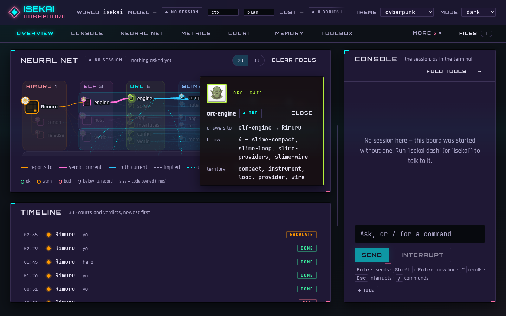

In 3D the same tree is a brain — Rimuru at the centre, each rank a shell further out, each lane a
tinted region (lane · heat · health), the minds a crown above:

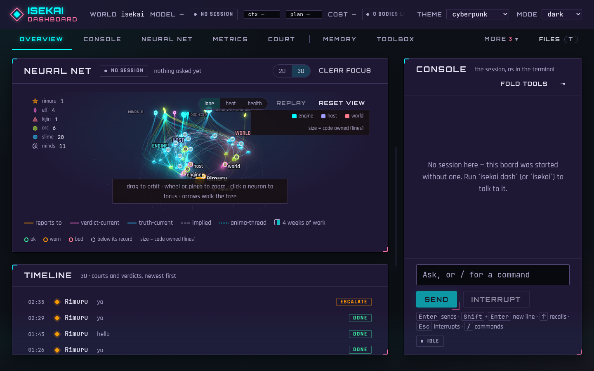

The tabs read the rest of the world: the court, memory, the toolbox, the metrics and value, and the
**config** — every resolved value, the file and line that set it, and a line saying what each key
does (a switch says on/off first):

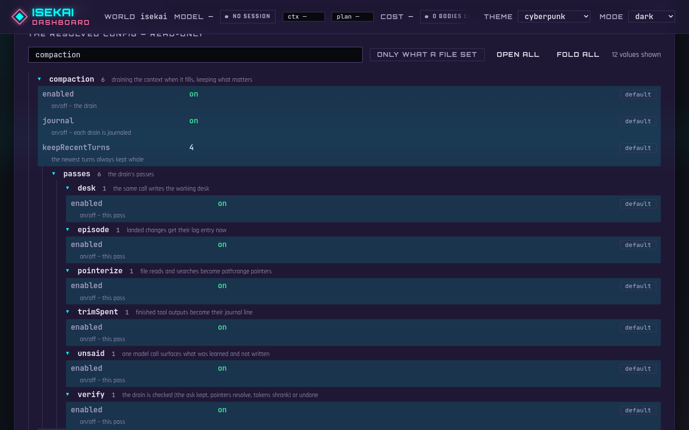

### Themes

One palette dresses both faces — the terminal and the dashboard — from one package of named
palettes (`theme/`), each with the same roles in a dark and a light variant: the tonal anchors of
the depth, the text tones, the primary and accent, the verdicts, the plan, the race lanes and the
tool classes. Seven are omoro.io's cyberpunk family, the eighth the dashboard's own HUD:

`/theme` alone opens the picker — every palette with its swatches, the one in use marked, the mode
under them; the frame wears the palette under the cursor as you move, enter keeps it:

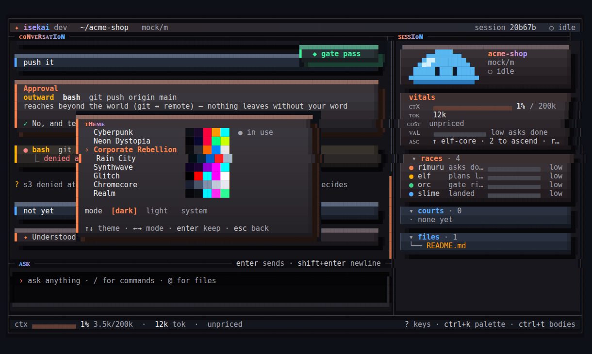

| `ui.theme` | from | the look |
|---|---|---|
| `cyberpunk` (default) | Void · Smog Purple · Danger Red · Amber Haze · Scanner Cyan | cyan on smog-violet, amber throne |
| `neon-dystopia` | Dark Street · Smog Sky · Danger Signal · System Green · Radiation | green and acid lime on a navy night |
| `corporate-rebellion` | Corp Shadow · Dark Grey · Warning Orange · Corp Blue · Report White | warning orange on grey, corp blue |
| `rain-city` | Night Rain · Wet Asphalt · Neon Reflection · Kanji Red · Rain Silver | neon blue on wet asphalt, kanji red |
| `synthwave` | Void · Dark Purple · Electric Purple · Neon Magenta · Electric Cyan | magenta and cyan on deep purple |
| `glitch` | Void · Alert Red · Data Cyan · Error Magenta · Bleed White | the RGB split on black |
| `chromecore` | Void Steel · Dark Steel · Gunmetal · Steel · Chrome White | liquid steel with a pale sheen |
| `realm` | the dashboard's neon HUD | cyan and magenta brackets on black |

Every text role holds 4.5:1 on every surface of every palette in both modes (a table test, and the
terminal's own over every row of its gradients); where a swatch could not, the palette's comment
says how it was retuned. `ui.mode` is `dark` (default), `light` or `system` (the terminal's
background, the browser's `prefers-color-scheme`). Switch live with `/theme synthwave light`,
`/settings`, or the dashboard's theme and mode menus: every surface follows at once, and the choice
is written to the world's `config.local.yaml`. `isekai config explain theme` lists them.

```yaml
ui: { theme: rain-city, mode: system }
```

## The CLI

| Command | What it does |
|---|---|
| `isekai` / `repl` | the live session: talk while Courts work; `/agents`, `/send`, `/usage`, `/status`, `/compact` |
| `run "<ask>"` | one ask to its end, non-interactive; `--json` for machines |
| `resume <id>` · `sessions` | continue or list sessions |
| `status` | every live reading (models, sandbox, guard, memory) and every law feature switched off, with where — gaps print as `@?` lines |
| `config show\|explain\|check\|path\|patch` | the effective config with the origin of every value |
| `memory` · `toolbox` · `onto` | the three memories, the two-level toolbox, the creature graph |
| `forge list\|show <id>\|mint <id> [--yes] [--version] [--force]\|reject <id> --why …` | the forge's desk, headless (§The forge) — `/forge` in a session |
| `q list\|show <id>\|add <ask>\|claim\|touch\|requeue\|close <id>` | the shared work queue: what is held, who holds what, every move one appended line; `--json` for scripts |
| `usage` | tokens and cost by body, office, rank, model and day |
| `bench` | a fixed task set on every configured model |
| `goal --validate "<cmd>" "<objective>"` | work turn after turn until the command passes; the binary runs it, the model cannot skip it |
| `review [range]` | two reviewers on two models in parallel, one merged shortlist; nothing fixed before you approve |
| `handoff [focus]` | a handoff note for a fresh session (`/handoff read` picks it up) |
| `install --claude [--global] [--yes]` · `hook <event>` | run the law inside Claude Code through its hooks (§Inside Claude Code) |
| `guard check\|test\|show\|export\|hook\|install` | the global dangerous-command guard; `install --yes` wires it into Claude Code and OpenCode |
| `ui init\|scan\|check` | web pages built from one token system: lay the foundation, regenerate the legend, lint and screenshot at 360/768/1280 in both themes |
| `dash [--open]` | the session in the browser, at the board's root: the cockpit, the console, the neural net, metrics, the Court's history, memory, toolbox, relations, the tree, config; approvals answered there |
| `board` | the dashboard, read-only, without a session, on 127.0.0.1 |
| `--docker-agent` | the whole binary in a Docker container: the world read-write, the rest read-only |
| `init [--level light\|medium\|complex]` | found a world: the law only; a colony read from the tree with no model — the build files (go.mod, package.json workspaces, pyproject, Cargo, Maven, Gradle), sizes and imports give a slime per package or module dir, orcs over related slimes, an elf per three orcs (lane elves and a canon elf on a large project), a kijin for CI and infra, verify lines only where tests exist, existing docs kept; or a founding session that reads all the code and decides the elves, orcs, slimes, kijin, minds, bodies and relations |
| `selftest` · `version` | |

## Configuration

Configuration is YAML (or JSON), layered — each layer overrides the one before it:

| Layer | Where | Kept in git |
|---|---|---|
| built-in defaults | in the binary — everything on | — |
| global | `~/.config/isekai/` | no |
| project | `.isekai/` in the world | yes |
| project local | `.isekai/config.local.yaml` | no (machine-only) |
| environment | `ISEKAI_CONFIG=<file>`, `ISEKAI_CONFIG_CONTENT=<yaml>`, `ISEKAI_MODEL`, `ISEKAI_DISABLE_PROJECT_CONFIG=1` (skip the project layers), `ISEKAI_PROVIDER_<NAME>_API_KEY` (built-in provider names only; a custom provider uses `apiKeyEnv`) | — |
| flags | `--model`, `--set key=value`, `--approve outward`, `--dry-run`, `--no-<feature>` (all of them: `isekai --help`) | — |

`isekai config explain` shows every effective value and the file and line it came from;
`isekai status` shows every model, the guard, the sandbox and anything switched off.

### Keys and registry credentials

Providers prefer `apiKeyEnv` (name the variable, never the value). Where an env var cannot exist —
headless containers — the designated escape is `providers.<name>.apiKey` holding the
literal; every other field still refuses credentials in a file (headers, urls, unknown keys).

`--docker-agent`'s registry pulls authenticate the same way: env-first, literal fallback —
`registry.containers: { usernameEnv, tokenEnv }` or `{ username, token }`. Docker receives the
token on stdin, never argv.

### One file per part

A layer can be one `config.yaml`, or split: beside it, a file named after a section holds just that
section. The example in [`examples/gateway/`](examples/gateway/) — isekai on vLLM-hosted models
behind a gateway — is laid out this way:

```
.isekai/
├── config.yaml        # the world's own settings
├── providers.yaml     # model endpoints
├── registry.yaml      # models, tools, package and container registries
├── models.yaml        # who runs on what
├── guards.yaml        # catastrophic commands, refused before any approval
├── rules.yaml         # rules every creature reads, optionally checked at the gate
└── permissions.yaml   # ask / allow / deny per command
```

**`providers.yaml`** — where the models are. Keys are named, never written:

```yaml
gateway:
  enabled: true
  type: openai                       # any OpenAI-compatible endpoint: vLLM, a gateway, OpenRouter, Ollama
  baseURL: https://llm-gateway.example.corp/v1
  apiKeyEnv: GATEWAY_API_KEY         # the variable's name; export the key in your shell
  toolCalls: native                  # vLLM with --enable-auto-tool-choice; "text" for tags in the text
  contextWindow: auto                # read from /v1/models (max_model_len)
  timeout: 10m
  # headers: { X-Tenant: platform }        # a routing header; a credential here is refused
  # tls: { caFile: /etc/ssl/certs/corp-ca.pem }
```

`contextWindow: auto` reads the served maximum from `/v1/models`; a gateway that does not report it
needs `contextWindow: <n>` here or per model in `registry.yaml`. (A provider named `vllm` needs no
`type`: it is known.)

**`registry.yaml`** — where things come from: the models a gateway serves, the tools the agent can
discover, a private Artifactory, the container registry (the example ships `packages` and `containers`
commented out):

```yaml
models:                                     # "<provider>/<id>" — tier orders the offices; price in USD per 1M tokens
  gateway/muse-glimmer: { tier: 1, contextWindow: 131072, price: { input: 0, output: 0 } }
  gateway/glm-5-3:      { tier: 2 }
  gateway/kimi-k3:      { tier: 3 }
tools:                                      # external tools the toolbox indexes
  - { name: kubectl, description: "the cluster CLI", triggers: [kube, pods, deploy] }
packages:                                   # set in every shell command and in the container
  npm: https://artifactory.example.corp/artifactory/api/npm/npm-remote/
  pip: https://artifactory.example.corp/artifactory/api/pypi/pypi-remote/simple
  go:  https://artifactory.example.corp/artifactory/api/go/go-remote
  auth: { usernameEnv: ARTIFACTORY_USER, tokenEnv: ARTIFACTORY_TOKEN }   # the login every manager presents
  # npmAuth / pipAuth / goAuth: { … }       # one manager's own login, over the shared one
  policy: private-only                      # all (default) | private-only: no package from anywhere else
  env: { GONOSUMDB: example.corp }
containers:                                 # for --docker-agent
  base: artifactory.example.corp/docker-remote/debian:bookworm-slim
  apt:  https://artifactory.example.corp/artifactory/debian-remote
  # image: artifactory.example.corp/docker-local/isekai-runtime:1   # pull a prebuilt runtime instead
```

Each package manager logs in the way it reads a login — the harness writes them under the world's
`tmp/registry/` (gitignored, owner-only), rewritten at every start: npm gets an npmrc whose token stays a
`${VAR}` reference npm expands itself, pip and uv get the login in their index URL, go gets a netrc for
its proxy host. The variables a login names are let through to the shell by name — the agent can read
them: use a read-only token. A literal `token:` is the fallback where no variable can exist, and only in
`config.local.yaml`; the tracked config refuses it.

`policy: private-only` keeps every manager on those URLs. GOPROXY loses its `direct` fallback, a manager
with no private URL is switched off (`GOPROXY=off`, `PIP_NO_INDEX=1`), and the guard refuses — before any
approval — a command that points a manager elsewhere (`--registry`, `--index-url`, `-i`, a `GOPROXY`
override, `npm config set registry`), installs from a URL or a repository (`pip install git+https://…`),
fetches from a public registry host, or installs with a manager that has no private URL.

For a private container registry, `docker login artifactory.example.corp` first: docker's own login
answers for the pull.

**`models.yaml`** — the session's model and the three offices (Great Sage reads, Raphael gives verdicts,
Ciel drafts). A call is retried on 429 and 5xx (honouring `Retry-After`); when it still fails, or
fails outright on a transport error, the fallback is tried — never on a refusal. An *office* is what a
Court Body does for a call; a *rank* is its place in the tree (elf → orc → slime); a *creature* is
one named body — each can be given its own model:

```yaml
default: { model: gateway/kimi-k3, fallback: gateway/glm-5-3 }
offices:
  great-sage: { model: gateway/muse-glimmer, fallback: gateway/glm-5-3 }
  raphael:    { model: gateway/glm-5-3,      fallback: gateway/kimi-k3 }
  ciel:       { model: gateway/kimi-k3,      fallback: gateway/glm-5-3 }
# ranks: { slime: …, orc: … }   creatures: { slime-auth: … }   tasks: { drain: …, gate: … }
```

**`guards.yaml`** — added to the built-in denylist (disk wipes, `rm -rf ~`, force-pushes, repository and
secret deletion, history purges, secret-store reads, `curl … | sh`). A match is refused before any
approval — no rule or `--approve` can run it:

```yaml
- '(^|[[:space:]])terraform[[:space:]]+destroy'
- 'kubectl[[:space:]]+delete[[:space:]]+(ns|namespace|node)'
- 'helm[[:space:]]+uninstall'
```

**`rules.yaml`** and **`permissions.yaml`**:

```yaml
# rules.yaml — every creature reads them; a check runs at the gate
- { text: "Tests must pass before a change lands.", check: "make test" }
- { text: "No secret, key or token is ever written to a file." }
```

```yaml
# permissions.yaml — ask / allow / deny per command. An allow on bash, git or webfetch is a
# loosening that `config check` lists; a bare bash:* allow is refused. In the tracked project
# layer an allow never pre-approves an outward or destructive act (a clone would carry it):
# put those in .isekai/config.local.yaml or the global config.
rules:
  - { match: "bash:git push*", action: ask }
  - { match: "bash:kubectl*", action: ask }
# and in .isekai/config.local.yaml, the machine's own word:
#   permissions: { rules: [{ match: "bash:kubectl get*", action: allow }] }
```

### Every other section

| Section | What it controls | A taste |
|---|---|---|
| `tools` | the builtin tools, their limits, custom tools, the bash sandbox | `bash: { sandbox: bwrap, timeout: 2m }` · `custom: { kube-pods: { run: [kubectl, get, pods], class: read } }` |
| `law` | the gate and its checks, the human gate, budgets per turn | `gate: { retries: 1, testsIntact: true }` · `humanGate: { approve: [outward] }` |
| `memory` · `compaction` | recall and notes; draining the context when it fills | `compaction: { trigger: { fraction: 0.85 } }` |
| `mcp` | MCP servers (Claude Code's `.mcp.json` and OpenCode's are imported) | `servers: { gh: { command: [gh-mcp] } }` |
| `hooks` | shell hooks at preTool, postTool, sessionStart, preCompact, stop, userPrompt | `preTool: [{ match: "bash", command: "./check.sh" }]` |
| `discovery` | where instructions, skills, commands and agents are found (Claude Code and OpenCode dirs included) | `skills: { paths: [.claude/skills] }` |
| `budgets` | spend ceilings for the session and each Court | `session: { tokens: 400000, usd: 5 }` |
| `law.value` | the one definition of success, the value ledger's window, each family's score and meter | `value: { window: 7d, minRecord: 8 }` · `families: { gate: { score: "0.6*gateRight + 0.4*slimeHealth" } }` |
| `ranks.<r>.value` · `.family` · `.portrait` | a race's own score, meter and record; its family; its picture | `slime: { value: { score: "0.5*landRate + 0.5*gateRate", meter: { signal: gateRate, bands: { ok: 85, warn: 60 } } } }` |
| `law.evolution` | when a stressed creature with an overflowing desk evolves (split, mutate, rebirth), auto or proposed | `evolution: { mode: propose, thoughtsMax: 9, cooldownRuns: 20 }` |
| `law.guts` | the per-step gut: benches (go, pytest, js, cargo, make), lexemes, weights, clamp; the stall guards `repin` (3) and `actBudget` (40) checkpoint a run that re-reads or lands nothing | `benches: [{ name: mix, match: ["mix test"], red: [failure], green: ["0 failures"] }]` |
| `ui` · `output` | the dashboard, the status line, the session's meters (ctx bands follow `law.budget`), output format | `board: { autostart: false }` · `meters: { score: { signal: score, bands: { ok: 75, warn: 45 } } }` |
| `ui.theme` · `ui.mode` | the palette both faces wear and its variant (§Themes) | `theme: synthwave` · `mode: system` |
| `sessions` · `undo` | where sessions and undo snapshots live, how long | `sessions: { keepDays: 30 }` |

| `toolbox` · `ontology` · `instruments` | the searchable tool registry, the creature graph, the journals | `toolbox: { budgetTokens: 1500 }` |
| `instruments.otlp` | OpenTelemetry trace export over OTLP/HTTP — a span per turn, court and tool call; off until your own config (global or local, never the project's) names the collector | `otlp: { enabled: true, endpoint: https://collector.example/v1/traces, headersEnv: { api_key: TRACE_API_KEY } }` |
| `mode` · `smallModel` · `logLevel` | `build` or `plan` (plan writes nothing); a small model for small tasks | `mode: plan` |
| `tools.profile` · `tools.missing` | the toolset shape (`max`, `anthropic`, `openai`, `minimal`); what happens when a tool is missing | `profile: minimal` |
| `permissions.import` · `mcp.import` | take Claude Code's and OpenCode's permissions and MCP servers | `import: { claudeCode: { enabled: false } }` |
| `guard` | more denylist files, patterns inline | `files: [~/corp-guards.txt]` |

Everything is on by default; switching something off is always shown in `status`, never silent.
`isekai config explain` shows every value with the file and line it came from. The full schema:
[`docs/canon/config.md`](docs/canon/config.md) · the design: [`docs/canon/binary.md`](docs/canon/binary.md) · the terminal:
[`docs/canon/tui.md`](docs/canon/tui.md) · each race's loop: [`docs/canon/races.md`](docs/canon/races.md).

## Web UIs

When the agent builds a page, it wears the built-in **`ui` Mind** (a project skill of the same name
overrides it). The app's own `ui/` dir is the source of truth; nothing is copied into the world:

```
ui/tokens.css      raw scales → meaning tokens (--surface --ink --accent --space-m --step-1 …), both themes, density
ui/palettes.css    thirteen palettes in OKLCH, contrast-checked; <html data-palette="forest"> swaps every colour
ui/layout.css      the page grid and primitives: .page .stack .cluster .grid .cols .sidebar .switcher .center .cover .frame
ui/components/<name>/<name>.{css,html}   one component; its css starts /* @component <name> — tokens: … */
```

A global or radical change is one edit in one tier (a palette, `--density`, `--type-ratio`, a
primitive); no component is touched. `isekai ui scan` derives the **legend** —
`.isekai/ui-assets/{manifest.json,legend.md,catalogue.html}`: every component, the classes it owns,
its variants, the tokens it reads. The agent reads it before it changes anything. `isekai ui check`
lints the system (no literal colour or pixel length outside the token files, every class declared,
every token defined, every header true) and renders the catalogue with headless Chromium at 360, 768
and 1280px in light and dark, failing any component that scrolls sideways. The gate runs the lints on
every turn that touched the ui dir (`law.gate.ui`). A project already on Tailwind, Bootstrap or a
design-system package keeps it: the Mind follows the existing system.

## Security

Defence in layers: what a body may do is decided in code, before and around every act — never by
asking the model to behave.

- **Every act is classed** — read, write, outward (leaves the machine: network, `git push`, a
  read of `/etc` or your home's secrets) or destructive (`rm -rf`, `git reset --hard`, history
  rewrites). Writes stay inside the world's territory; outward and destructive acts ask you first
  (the human gate), in the terminal or the dashboard. A command is classed by its real name
  however it is called (`/usr/bin/git`, `\rm`, `sudo env -i /bin/rm`, `xargs`, `bash -c "…"`), and
  an allow rule never carries a chained act (`npm test && curl …` needs the curl allowed too).
- **The guard** — the catastrophic and irreversible are refused before any approval, held to a
  155-case test corpus; `isekai guard install --yes` wires the same list into Claude Code and
  OpenCode (without `--yes` it only shows the change).
- **The gate** — at the end of a turn it checks the author, the creatures' verify lines as they
  stood *before* the turn (a body never runs a check it just wrote), the duties and the docs; it
  fails a turn that deleted or skipped tests and sends a failure back once, then to you.
- **A clone cannot loosen the law** — the tracked `.isekai/config.yaml` may tighten but never
  switch off the human gate or pre-approve outward/destructive acts; that only comes from
  `config.local.yaml` or your global config, and `status` names every standing approval.
- **Secrets never ride along** — API keys are named by their environment variable, never written
  in a file; every child process gets a scrubbed environment (names holding `API_KEY`, `TOKEN`,
  `SECRET`, `PASSWORD`, `PRIVATE_KEY`, `ACCESS_KEY`, `CREDENTIAL`, and URLs carrying a password).
- **Every command has a deadline** — a timeout kills the command's whole process tree.
- **The dashboard** binds `127.0.0.1` only, guards every act with a session token and a same-origin
  check, and serves a strict self-only Content-Security-Policy (no CDN, fonts bundled).
- **Inside Claude Code** the hooks only ever tighten Claude Code's own permissions — they deny or
  ask, never allow.
- **Dry-run and previews** — `--dry-run` plans and shows what it would run or ask, running nothing;
  every edit shows its diff; `ctrl+t` and the dashboard show every agent live.

### The sandbox

Every shell command, verify line, hook and custom tool runs fenced, by the platform's own
sandbox, probed once at start — on **Linux** [bubblewrap](https://github.com/containers/bubblewrap)
(`bwrap`), on **macOS** Seatbelt (`/usr/bin/sandbox-exec`). `isekai status` prints
`sandbox: bwrap (<version>)` or `sandbox: seatbelt (sandbox-exec)`, or why it is off:

| inside the sandbox | Linux (bwrap) | macOS (Seatbelt) |
|---|---|---|
| the world's directory | read-write | read-write |
| temp | a private `/tmp` | read-write `/tmp` and `$TMPDIR` (`/private/var/folders`) — shared with the host |
| the rest of the disk | read-only | read-only |
| your credentials — `~/.ssh`, `~/.gnupg`, `~/.aws`, `~/.azure`, `~/.kube`, `~/.docker`, `~/.netrc`, `~/.git-credentials`, `~/.npmrc`, `~/.pypirc`, `~/.config/gcloud`, `~/.config/gh`, password stores, keyrings, browser profiles | masked: they read as empty | denied (read and write), plus `~/Library/Keychains`, `~/Library/Cookies` and the Safari, Chrome, Chromium, Brave, Edge, Firefox and Arc profiles |
| the network | off, unless the act passed the human gate as outward | off but loopback and unix sockets (DNS too), unless outward |
| other processes | out of sight (own pid, ipc and uts namespaces) | still listed (`ps`), but cannot be inspected or signalled |
| the command's life | dies with isekai; killed whole at its timeout | killed whole at its timeout |

It is a strong fence for a coding agent, not a virtual machine: the read-only rest of the disk is
still readable (the classifier asks before an outward read, the sandbox does not hide it), and
bwrap needs unprivileged user namespaces — some kernels and containers refuse them, and then the
shell runs unsandboxed and `status` says so. `tools.bash.sandbox: none` turns it off on purpose,
on either OS (`bwrap`, the default, means "the platform's fence" on a Mac too).

On a Mac, Seatbelt's limits:

- **It starts from allow-all and fences** — writes, network, credentials, other processes, Apple
  Events to other apps, LaunchServices (`open`) and the clipboard — rather than denying all and
  listing what toolchains need, which breaks Xcode, JVMs and native builds it cannot foresee (the
  choice Bazel's macOS sandbox makes). Mach IPC otherwise stays open: a hostile binary could ask
  launchd (`launchctl`) to start something outside the fence, and the login keychain answers the
  `security` tool through its own prompts. It fences a model's mistakes; for untrusted code use
  `--docker-agent`.
- **No pid namespace** — other processes stay visible to `ps`; a command does not die with
  isekai if isekai itself is killed hard (it still dies at its timeout).
- **Loopback and unix sockets stay open** with the network off, so a test can serve itself — and
  a local daemon (a database on `localhost`, Docker's socket, `ssh-agent`) stays reachable, as
  under bwrap.
- **Caches under your home are read-only** (`~/Library/Caches`, so `GOCACHE`): point them into
  the world or `$TMPDIR`.
- **`sandbox-exec` is deprecated by Apple** but ships with every macOS and runs Codex CLI's and
  Claude Code's sandboxes. isekai's CI has no Mac: `go test ./sandbox/ -run Seatbelt -v` on a Mac
  proves the fence there; if this macOS refuses the profile, `status` says `sandbox: none —
  sandbox-exec refused: …`.

For a harder boundary on either OS, **`--docker-agent`** runs the whole binary inside a Docker
container (Docker Desktop, OrbStack or colima on a Mac): the world mounted read-write, the rest
read-only, pulled or built from your private registry (`registry.containers`). Inside it,
`law.humanGate.trustContainer` lets the container be the membrane.

The built-in runtime is a slim Debian with git, Python and the text tools. For a full one — Go,
Node.js LTS with npm, pnpm and yarn, Python with pip and uv, build essentials, gopls, staticcheck,
ruff, pytest and a headless Chromium — use the prebuilt image, or build it from
[`docker/runtime/`](docker/runtime/Dockerfile):

```bash
isekai --docker-agent --image montabouagina/kaginari:v0.3.0
# or keep it in config:  registry: { containers: { image: montabouagina/kaginari:v0.3.0 } }
```

The session runs as your uid with a fresh tmpfs home, so tools keep their caches and global installs
under `/tmp` (GOPATH, npm's global prefix, pip's user base) and leave nothing behind.

## Benchmarks

Benchmarks run under [Harbor](https://github.com/harbor-framework/harbor) in Docker — one container
per task, the agent inside it, the task's own tests deciding. Every launch is recorded in
[`bench/runs.jsonl`](bench/runs.jsonl); [`bench/RESULTS.md`](bench/RESULTS.md) is generated from it.
The €0 smoke (`bench/smoke.sh`) runs on every commit in CI against a fake OpenAI-compatible server.

### Experimental loop features (off-switches, measured)

| feature | default | off with |
|---|---|---|
| `law.guts` | on | `--set law.guts.enabled=false` |
| `law.closingCheck` | on under bench, off live | `--set law.closingCheck.enabled=false` |
| echo penalty + witness admissibility | inside guts / closingCheck | ride their toggles |

Same 6 tasks × 2 attempts, the same model via an OpenAI-compatible gateway, same cells:

| run | loop state | score | input / out |
|---|---|---|---|
| `tb2-final-165052` | everything off | 8/12 (.67) | 3.1M / 0.25M |
| `tb2-fixed-220431` | laws + ceilings off | 7/12 (.58) | 2.4M / 0.18M |
| `tb2-clean-010744` | + witness close + guts | **10/12 (.83)** | 12.2M / 0.32M |
| `tb2-final2-024306` | + echo + admissibility | **10/12 (.83)** | **5.8M** / 0.25M |

On tokens: the winning harness grid spent 5.8M in / 0.25M out against the control's 6.1M in / 78k
out.

agent-one's current loop needs **23% less input per point of score** than the control's weakest
day — same tasks, same model. (For honesty: the control's best reading tonight was 0.92 — its loop
never changed; lifts came only from fixes around it. gcode-to-text sits at the model's glyph
precision edge for every harness: probe runs read the flag twice and miss a 0/O glyph; refusals
are honest, not confused.)

The culture that came from the bench is in [`examples/world-rules.yaml`](examples/world-rules.yaml)
— two laws earned, kept as principles, plus the close-time falsification witness (`law.closingCheck`)
and the per-step value sense (`law.guts`) they motivated.

## License

MIT — see [LICENSE](LICENSE). The dashboard's faces (Orbitron, Rajdhani, JetBrains Mono, embedded in the board) are SIL OFL.
